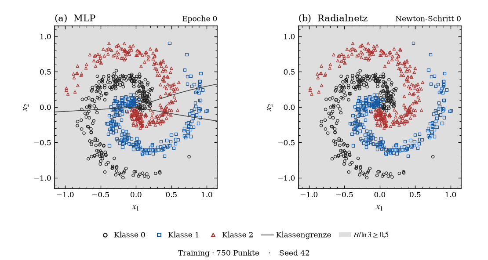

# Drei verrauschte Spiralen

Eine Drehung um 120° führt bei diesen Daten von einem Spiralarm zum nächsten. Ein gewöhnliches MLP bekommt nur die beiden Koordinaten. Das Radialnetz bekommt zusätzlich die Annahme, dass eine solche Drehung die drei Ausgänge zyklisch vertauscht. Ob sich das bei 750 Trainingspunkten bemerkbar macht, lässt sich direkt am alten MLP-Lauf prüfen.

*Animation. Links das MLP, rechts das Radialnetz. Beide sehen dieselben 750 Trainingspunkte, am Schluss die 300 Testpunkte. Die Zähler über den Panels geben den tatsächlichen Modellstand an. Ein Newton-Schritt und eine MLP-Epoche haben unterschiedliche Rechenkosten.*

## Seed 42

Das MLP hat fünf Fehler, das Radialnetz vier. Es gibt genau einen Testpunkt, bei dem die beiden unterschiedliche Klassen wählen. Der liegt bei $(x_1,x_2)=(0{,}0133,\,0{,}0616)$ und gehört zu Klasse 1. Das MLP gibt dieser Klasse 17,1 %, das Radialnetz 50,6 %. Auch beim Radialnetz ist die Entscheidung also knapp. Alle falsch klassifizierten Punkte liegen bei $r<0{,}11$. [Einzelvorhersagen MLP](results/predictions.csv) · [Einzelvorhersagen Radialnetz](results/radial_predictions.csv)

*Abb. 1. Klassengrenzen für Seed 42 nach Auswahl des Modellstands. Die offenen Symbole geben die wahre Klasse an, schwarze Kreuze markieren Fehlentscheidungen. Grau ist der Bereich mit $H(p)/\ln 3\geq 0{,}5$ und $H(p)=-\sum_k p_k\ln p_k$. C wertet die Wahrscheinlichkeiten auf 61 × 61 Rasterpunkten aus. Für die Grenzlinien interpoliert Python linear auf den Dreiecken jeder Rasterzelle. Für das graue Band wird die Entropie der interpolierten Wahrscheinlichkeiten auf einem feineren Raster ausgewertet. Die Klassifikation der Testpunkte stammt direkt aus C.* [Vektorfassung](assets/entscheidungsgrenzen.svg)

## Vergleich über fünf Seeds

Pro Seed werden 750 Trainings-, 210 Validierungs- und 300 Testpunkte gezogen. Alle drei Modelle erhalten jeweils dieselben Stichproben. Acht Stützstellen, die Regularisierung und die Folge der Seeds 42 bis 46 standen vor der neuen Testauswertung fest. Der Lauf mit Seed 42 war im ursprünglichen MLP-Projekt bereits veröffentlicht.

| Modell | Freie Gewichte und Biaswerte | Richtig im Test | Trefferquote | Mittlere Test-Kreuzentropie |
| --- | ---: | ---: | ---: | ---: |
| Lineare Softmax-Regression | 9 | 649 / 1 500 | 43,27 % | 0,9202 |
| MLP mit zwei Tanh-Schichten | 1 251 | 1 467 / 1 500 | 97,80 % | 0,1234 |
| Radialnetz mit 120°-Symmetrie | 16 | 1 482 / 1 500 | 98,80 % | 0,0366 |

*Abb. 2. Test-Kreuzentropie (a) und Trefferquote (b) für einzelne Läufe. Jede graue Linie verbindet die Messwerte derselben Stichprobe. Die Kreuzentropie verwendet den natürlichen Logarithmus. Sie zählt auch, wie viel Wahrscheinlichkeit auf der wahren Klasse liegt.* [Messwerte](results/vergleich.csv) · [Vektorfassung](assets/vergleich.svg)

Bei allen fünf Seeds liegt der Verlust des Radialnetzes niedriger. Bei der Trefferquote allein sieht mans kaum. Für die vier Punkte aus Seed 42, die beide Modelle falsch einordnen, beträgt der mittlere Verlust 3,24 beim MLP und 1,57 beim Radialnetz. Das Ergebnis gilt zunächst für diesen Generator mit genau drei gegeneinander verdrehten Armen.

## Rechnung

**Datensatz.** Für jede Klasse $k\in\{0,1,2\}$ wird $u$ gleichverteilt aus $[0,1)$ gezogen. Für das Winkelrauschen und die Streuung der Koordinaten verwendet C unabhängige Standardnormalvariablen $\epsilon_\theta,\epsilon_1,\epsilon_2$.

$$
r=0{,}04+0{,}96u,\quad \theta=2\pi k/3+4{,}8u+0{,}28\epsilon_\theta,\quad
x=(r\cos\theta+0{,}035\epsilon_1,\ r\sin\theta+0{,}035\epsilon_2).
$$

**Radialnetz.** Der Eingaberadius ist $\lVert x\rVert_2$, gemessen an den verrauschten Koordinaten. Zwischen null und dem größten Trainingsradius liegen acht gleichmäßig verteilte Stützstellen. Zu jeder gehört ein gelernter Vektor $v_j\in\mathbb R^2$. Dazwischen wird linear interpoliert, außerhalb des Trainingsintervalls gilt der letzte Vektor. Das ergibt acht feste Hutfunktionen mit insgesamt 16 freien Gewichten.

Für $R$, die positive 120°-Drehung, lauten die Logits und Wahrscheinlichkeiten

$$
z_k(x)=v(\lVert x\rVert_2)^\top R^{-k}x,\qquad
p_k(x)=\frac{\exp z_k(x)}{\sum_{j=0}^{2}\exp z_j(x)}.
$$

Es folgt $p_{k+1}(Rx)=p_k(x)$ mit zyklischen Indizes. Am Ursprung gilt $p_k=1/3$. Auf jedem Kreis mit $v(r)\ne0$ teilen sich die Klassen in drei gleich breite Winkelsektoren. Das ist eine stärkere Annahme als die Drehsymmetrie allein. Orientierung und Trennschärfe lernt das Modell aus den beschrifteten Trainingspunkten. Die Spiralsteigung und das Rauschen des Generators gehen dabei nicht in die Rechnung ein.

Der Optimierer minimiert die mittlere Trainings-Kreuzentropie plus $\lambda\lVert w\rVert_2^2/2$ mit $\lambda=10^{-5}$. Weil die Logits linear in den Gewichten sind, hat die Hesse-Matrix die Form einer gemittelten Kovarianz der Klassenmerkmale plus $\lambda I$. C löst das kleine Newton-System per Cholesky-Zerlegung und prüft die Schrittweite mit Armijo-Backtracking. Die berichteten Kreuzentropien enthalten nur den Datenverlust.

**Baselines.** Das MLP verwendet zwei Tanh-Schichten der Breite 32 und drei Softmax-Logits. Der bisherige Lauf verwendet Xavier-Initialisierung, 200 Epochen, Batches von 32 Punkten und Adam mit Lernrate 0,003, $\beta_1=0{,}9$, $\beta_2=0{,}999$ und $\epsilon=10^{-8}$. Die lineare Referenz lernt drei affine Funktionen der Koordinaten. Hier endet der Full-Batch-Gradientenabstieg bei einer Gradientennorm von höchstens $10^{-8}$. [Xavier-Initialisierung](https://proceedings.mlr.press/v9/glorot10a.html) · [Adam](https://arxiv.org/abs/1412.6980)

*Abb. 3. Verlust während des Trainings für Seed 42 auf gemeinsamer logarithmischer Ordinate. Der Kreis kennzeichnet den kleinsten Validierungsverlust. Beim MLP liegt er in Epoche 172, beim Radialnetz nach Newton-Schritt 7. Diese beiden Modellstände gingen in den Test.* [Vektorfassung](assets/training.svg)

## Nachrechnen

C11 genügt für beide Modelle und die Auswertung. Unter Windows mit GCC und PowerShell im Projektordner ausführen.

~~~powershell
gcc -std=c11 -O2 -Wall -Wextra -Wpedantic src/main.c src/experiment.c src/nn.c src/radial.c -o spiralnet.exe -lm
.\spiralnet.exe check
.\spiralnet.exe predict results/radial.nn 0.5 0
.\spiralnet.exe train --out lauf --seed 42
.\spiralnet.exe study --out studie --seed 42
~~~

Unter Linux und macOS

~~~sh
cc -std=c11 -O2 -Wall -Wextra -Wpedantic src/main.c src/experiment.c src/nn.c src/radial.c -o spiralnet -lm
./spiralnet check
./spiralnet predict results/model.nn 0.5 0
./spiralnet train --out lauf --seed 42
./spiralnet study --out studie --seed 42
~~~

**train** rechnet einen Seed und speichert beide gewählten Modelle. **study** rechnet fünf aufeinanderfolgende Seeds und schreibt **vergleich.csv**. Beide Befehle legen einen neuen Zielordner an. Mit **--width**, **--epochs** und **--lr** lassen sich die MLP-Parameter ändern. **predict** liest beide Modellformate. Bei gleichem Build und Seed sind die Ergebnisdateien reproduzierbar. Andere Mathematikbibliotheken können Rundungsunterschiede erzeugen.

Die Papierabbildungen werden als SVG und PNG ausgegeben, der Ablauf als GIF. Der erste Aufruf verwendet die mitgelieferten Daten, der zweite den selbst berechneten Lauf.

~~~sh
python -m pip install -r requirements-plot.txt
python visualisieren.py
python visualisieren.py --run lauf --study studie/vergleich.csv --out lauf/grafiken
~~~

**Tests.** Der C-Selbsttest prüft MLP-Backpropagation, den ersten Adam-Schritt und Softmax bei extremen Logits. Für das Radialnetz werden Gradient und Hesse-Matrix mit finiten Differenzen geprüft, außerdem der Abstieg des Newton-Schritts und die zyklische Vertauschung der Ausgänge bei einer 120°-Drehung. Der Integrationstest prüft die Reproduzierbarkeit, die Wahl des kleinsten Validierungsverlustes, beide Checkpoint-Formate sowie die Übereinstimmung von Einzellauf und Studie.

~~~sh
cmake -S . -B build -DCMAKE_BUILD_TYPE=Release
cmake --build build --config Release
cd build
ctest -C Release --output-on-failure
~~~

[MLP und Adam](src/nn.c) · [Radialnetz und Newton-Verfahren](src/radial.c) · [Datenerzeugung und Training](src/experiment.c) · [Abbildungen](visualisieren.py)
