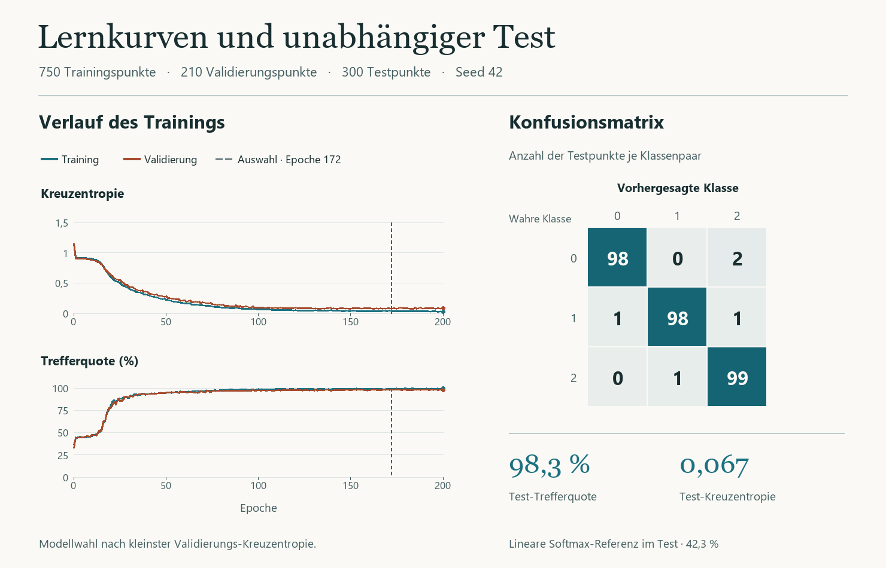

# Wie ein neuronales Netz drei Spiralen trennt

Jeder Punkt hat zwei Koordinaten und gehört zu einem von drei verrauschten Spiralarmen. Ein neuronales Netz lernt aus beschrifteten Beispielen, wo die Grenzen zwischen den Armen verlaufen. Der gesamte Rechenweg vom Zufallspunkt bis zur Testvorhersage ist in **C11** implementiert. Python zeichnet die in C berechneten Wahrscheinlichkeiten und Messreihen.

## Ergebnis des mitgelieferten Laufs

| Modell | Trainierbare Parameter | Richtige Vorhersagen | Testgenauigkeit | Test-Kreuzentropie |
| --- | ---: | ---: | ---: | ---: |
| Lineare Softmax-Regression | 9 | 127 / 300 | 42,33 % | 0,89996 |
| Netz mit zwei Tanh-Schichten | 1 251 | 295 / 300 | 98,33 % | 0,06680 |

Bei der linearen Regression liegt die Grenze zwischen zwei Klassen auf einer Geraden. Die verdeckten Schichten des Netzes können eine gekrümmte Grenze entlang jedes Spiralarms formen. Alle fünf Fehler des Netzes liegen in der Nähe des Ursprungs, wo schon eine kleine Verschiebung des Punkts die Arme überlappen lässt. Die Werte oben stammen aus einem reproduzierbaren Lauf mit Seed 42. [Messwerte](results/summary.csv) · [Vorhersagen für alle 300 Testpunkte](results/predictions.csv)

Die Helligkeit rechts beschreibt, wie gleichmäßig das Netz seine Wahrscheinlichkeit auf die drei Klassen verteilt. Dargestellt ist die normierte Entropie $H(p)=-\sum_k p_k\log(p_k)/\log(3)$. Eine gleichmäßige Verteilung ergibt 1, eine vollständig auf eine Klasse konzentrierte Verteilung 0. C wertet das Modell auf einem Raster von 61 × 61 Punkten aus. Python interpoliert die Wahrscheinlichkeiten für die Abbildung bilinear. Die Fehlermarkierungen stammen aus der direkten Vorhersage an jeder Testkoordinate.

## Selbst ausführen

**Windows mit GCC und PowerShell.** Im Wurzelordner des Projekts ausführen. Der erste Befehl übersetzt das gesamte Programm. `predict` funktioniert sofort mit dem mitgelieferten Modell.

~~~powershell
gcc -std=c11 -O2 -Wall -Wextra -Wpedantic src/main.c src/nn.c src/experiment.c -o spiralnet.exe -lm
.\spiralnet.exe check
.\spiralnet.exe predict results/model.nn 0.5 0
.\spiralnet.exe train --out lauf --seed 42 --epochs 200 --width 32 --lr 0.003
~~~

**Linux und macOS mit einem C11-Compiler.**

~~~sh
cc -std=c11 -O2 -Wall -Wextra -Wpedantic src/main.c src/nn.c src/experiment.c -o spiralnet -lm
./spiralnet check
./spiralnet predict results/model.nn 0.5 0
./spiralnet train --out lauf
~~~

`train` legt für jedes Experiment einen neuen Ordner an. Beim nächsten Durchgang kannst du etwa mit `--out lauf-schmal --width 4` untersuchen, wie sich eine schmalere Architektur auf die Grenzen auswirkt. Breiten von 1 bis 256 sind möglich. Mit gleichem Seed erhältst du dieselben Punkte und dieselbe Mischreihenfolge. Unterschiede zwischen Compilern oder Mathematikbibliotheken können den numerischen Trainingsverlauf beeinflussen.

**Grafiken erzeugen.** Für die Darstellung werden Python, NumPy und Pillow benötigt. Das folgende Beispiel rendert einen eigenen Lauf. Ohne Argumente verwendet das Skript die mitgelieferten Daten aus `results/` und schreibt nach `assets/`.

~~~sh
python -m pip install -r requirements-plot.txt
python visualisieren.py --run lauf --out lauf/grafiken
~~~

## Versuchsaufbau

Für die Klasse $k \in \{0,1,2\}$ wird $u$ gleichverteilt aus $[0,1)$ gezogen. Drei unabhängige standardnormalverteilte Zufallsgrößen $\epsilon_\theta,\epsilon_1,\epsilon_2$ bringen Streuung in die Richtung und die Koordinaten.

$$
r=0{,}04+0{,}96u,\qquad \theta=2\pi k/3+4{,}8u+0{,}28\epsilon_\theta
$$

$$
x_1=r\cos\theta+0{,}035\epsilon_1,\qquad x_2=r\sin\theta+0{,}035\epsilon_2
$$

Jede Klasse liefert 250 Trainings-, 70 Validierungs- und 100 Testpunkte. Getrennte Zufallsfolgen steuern die drei Stichproben, die Initialisierung und das Mischen der Minibatches. In jeder Epoche durchläuft das Netz alle 750 Trainingspunkte. Die 210 Validierungspunkte entscheiden, welcher Modellstand gespeichert bleibt. Beim Standardlauf liegt das Minimum der Validierungs-Kreuzentropie in Epoche **172 von 200**. Erst nach dieser Auswahl werden beide Modelle an denselben 300 Testpunkten gemessen.

## Was im C-Kern passiert

1. **Vorwärtsrechnung.** Zwei voll verbundene Schichten mit je 32 Neuronen berechnen $h_1=\tanh(W_1x+b_1)$ und $h_2=\tanh(W_2h_1+b_2)$. Die Ausgabeschicht liefert drei Logits $z=W_3h_2+b_3$. Die Gewichte starten gleichverteilt innerhalb der Xavier-Grenzen, die Biaswerte bei null. [Glorot und Bengio, 2010](https://proceedings.mlr.press/v9/glorot10a.html)
2. **Verlust und Rückwärtsrechnung.** Für die wahre Klasse $y$ und $m=\max_k z_k$ berechnet C den Verlust als $(m-z_y)+\log\sum_k\exp(z_k-m)$. Das bleibt auch dann auswertbar, wenn die Wahrscheinlichkeit einer Klasse numerisch auf null fällt. Vom Ausgangsgradienten $p-\mathrm{onehot}(y)$ läuft die Kettenregel durch beide Tanh-Schichten. Die Ableitung jeder Tanh-Aktivierung $h$ ist $1-h^2$.
3. **Optimierung.** Ein Adam-Schritt verwendet die mittleren Gradienten eines Minibatches von bis zu 32 Punkten. Die Standardwerte sind Lernrate 0,003, $\beta_1=0{,}9$, $\beta_2=0{,}999$ und $\epsilon=10^{-8}$ mit Bias-Korrektur für beide Momente. [Kingma und Ba, 2014](https://arxiv.org/abs/1412.6980)
4. **Lineares Vergleichsmodell.** Eine multinomiale logistische Regression verwendet dieselben beiden Koordinaten und Trainingspunkte. Full-Batch-Gradientenabstieg minimiert die konvexe Kreuzentropie bis zu einer Gradientennorm von höchstens $10^{-8}$. Für den Schritt $1/L$ verwendet der Code die globale Schranke $L=\tfrac12\,\mathrm{mean}(1+x_1^2+x_2^2)$.

## Nachrechnen und weiterverwenden

`spiralnet check` vergleicht die analytische Backpropagation eines kleinen Netzes mit zentralen finiten Differenzen für jedes seiner 47 Gewichte und Biaswerte. Im Referenz-Build betrug die größte absolute Abweichung **1,52 × 10⁻¹¹**. Weitere Prüfungen vergleichen den ersten Adam-Schritt mit der direkten Rechnung und testen Softmax und Kreuzentropie bei extremen Logits.

Mit CMake ab 3.16 laufen zusätzlich zwei kurze Trainingsläufe durch dieselbe Kommandozeile. Der Integrationstest vergleicht alle Ausgabedateien beider Läufe byteweise, prüft eine Vorhersage aus dem neu geladenen Modell und die Erkennung eines beschädigten Checkpoints.

~~~sh
cmake -S . -B build -DCMAKE_BUILD_TYPE=Release
cmake --build build --config Release
cd build
ctest -C Release --output-on-failure
~~~

| Datei | Inhalt |
| --- | --- |
| [src/nn.c](src/nn.c) | Vorwärtsrechnung, Backpropagation, Adam, numerische Tests und Modellformat |
| [src/experiment.c](src/experiment.c) | Datengenerator, Trainingsschleife, Modellauswahl, lineare Referenz und Auswertung |
| [visualisieren.py](visualisieren.py) | Entscheidungskarte, Entropie, Lernkurven, Konfusionsmatrix und Animation |
| [results/model.nn](results/model.nn) | Gewichte und Biaswerte des ausgewählten Modells, versioniertes Binärformat mit Prüfsumme für die Inferenz |
| [results/points.csv](results/points.csv) | Koordinaten, wahre Klassen und Zugehörigkeit zu Training, Validierung oder Test |
| [results/history.csv](results/history.csv) | Kreuzentropie und Trefferquote für Training und Validierung in jeder Epoche einschließlich Initialisierung |
| [results/surface.csv](results/surface.csv) | Drei Klassenwahrscheinlichkeiten je Rasterpunkt und Modellstand, im letzten Frame der ausgewählte Checkpoint |
