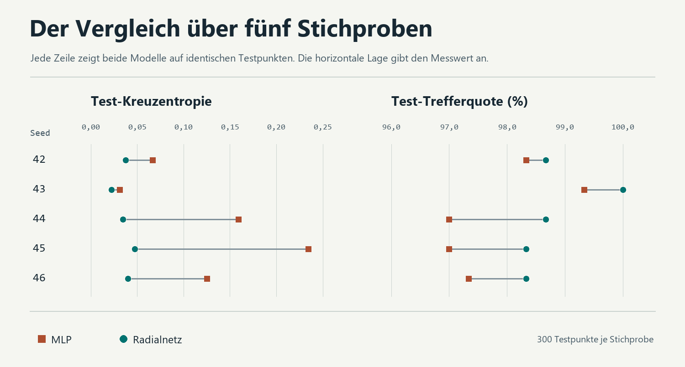
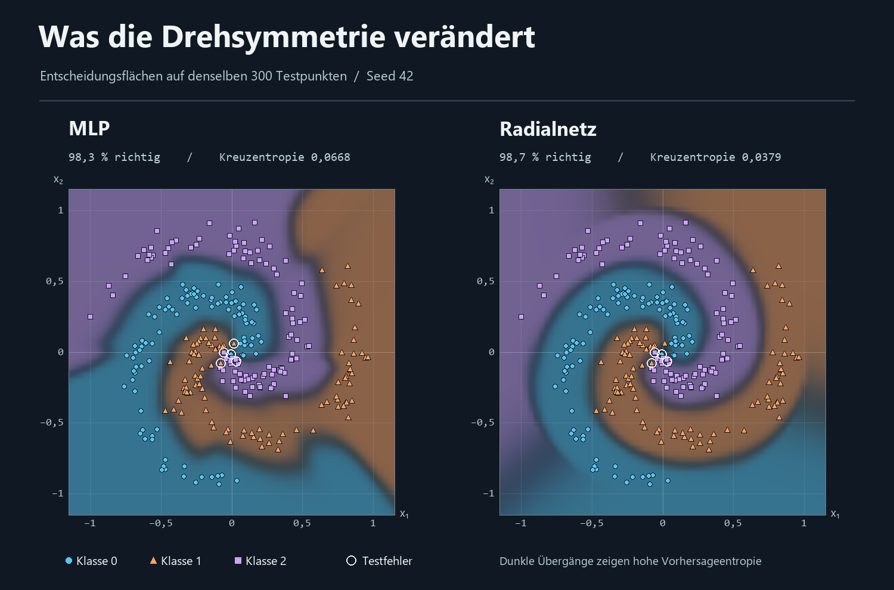

# Drei Spiralen lernen

Wie viel muss ein Klassifikator aus Beispielen lernen, wenn ein Teil der Geometrie bereits bekannt ist? In diesem Experiment vertauscht eine Drehung um 120° die drei Klassen zyklisch. Ein gewöhnliches neuronales Netz lernt die drei Arme einzeln. Ein zweites Modell teilt 16 Gewichte zwischen den Armen und lernt, wie sich ihre Richtung und Trennschärfe mit dem Radius ändern. Datengenerator, Modelle, Optimierer, Modellauswahl und Vorhersagen sind in **C11** implementiert. Python rendert die vom C-Programm exportierten Werte.

## Was bringt die Symmetrie?

Über fünf vorab festgelegte Seeds verbessert das Radialnetz die mittlere **Test-Kreuzentropie von 0,1234 auf 0,0366**. Die Trefferquote steigt von **97,8 % auf 98,8 %**. Die Kreuzentropie misst auch, wie viel Wahrscheinlichkeit ein Modell der wahren Klasse gibt. Eine sehr selbstsichere Fehlentscheidung wiegt deshalb stärker als eine knappe.

| Modell | Trainierbare Parameter | Richtige Vorhersagen in 5 Läufen | Test-Trefferquote | Mittlere Test-Kreuzentropie |
| --- | ---: | ---: | ---: | ---: |
| Lineare Softmax-Regression | 9 | 649 / 1 500 | 43,27 % | 0,9202 |
| MLP mit zwei Tanh-Schichten | 1 251 | 1 467 / 1 500 | 97,80 % | 0,1234 |
| Rotationsäquivariantes Radialnetz | 16 | 1 482 / 1 500 | 98,80 % | 0,0366 |

Jeder der fünf Läufe mit Seed 42 bis 46 zieht neue, klassenbalancierte Trainings-, Validierungs- und Teststichproben mit 750, 210 und 300 Punkten. Innerhalb eines Laufs sehen alle Modelle exakt dieselben Beispiele. Die Architektur, die acht radialen Stützstellen, die Regularisierung und die Seedfolge standen vor der neuen Testauswertung fest. Der Beispieldatensatz mit Seed 42 war bereits im ursprünglichen MLP-Projekt veröffentlicht. Die fünf gepaarten Ergebnisse beschreiben diesen synthetischen Datengenerator. Bei anders angeordneten Klassen kann die eingebaute Symmetrie unpassend sein. [Messwerte je Seed](results/vergleich.csv)

## Wo die Modelle Fehler machen

Für Seed 42 klassifiziert das Radialnetz 296 der 300 Testpunkte richtig, das MLP 295. Der Unterschied konzentriert sich auf die überlappenden Arme nahe der Mitte. Außerhalb dicht besetzter Punktwolken zeigen die Flächen, wie die Modelle zwischen den Beobachtungen und über sie hinaus extrapolieren. Dort fehlen häufig Testpunkte, mit denen sich die Vorhersage beurteilen ließe. [Vorhersagen des MLP](results/predictions.csv) · [Vorhersagen des Radialnetzes](results/radial_predictions.csv)

Beide Karten verwenden dasselbe Raster von 61 × 61 C-Auswertungen. Python interpoliert die drei Wahrscheinlichkeiten bilinear. In satt gefärbten Gebieten konzentriert sich die Vorhersage auf eine Klasse. Dunkle Bereiche zeigen hohe normierte Entropie $H(p)=-\sum_k p_k\log(p_k)/\log 3$. Die Fehlermarkierungen verwenden die exakte Modellvorhersage an jedem Testpunkt.

## Wie das Radialnetz funktioniert

Aus $x=(x_1,x_2)$ berechnet das Modell den Radius $r=\lVert x\rVert_2$. Zwischen null und dem größten **Trainingsradius** liegen acht gleichmäßig verteilte Stützstellen. Jeder Stützstelle $j$ ist ein lernbarer Vektor $v_j\in\mathbb{R}^2$ zugeordnet. Lineare Interpolation der benachbarten Vektoren ergibt $v(r)$. Oberhalb des größten Trainingsradius bleibt der letzte Vektor gültig. Das entspricht einer Schicht aus festen, stückweise linearen Hutfunktionen mit trainierbaren Auslesegewichten.

Für die Drehmatrix $R$ einer positiven 120°-Drehung lauten die drei Logits und Wahrscheinlichkeiten

$$
z_k(x)=v(\lVert x\rVert_2)^\top R^{-k}x,\qquad
p_k(x)=\frac{\exp z_k(x)}{\sum_{j=0}^{2}\exp z_j(x)}.
$$

Damit folgt $p_{k+1}(Rx)=p_k(x)$ mit zyklischen Indizes. Am Ursprung sind alle drei Wahrscheinlichkeiten gleich. Auf einem Kreis mit $v(r)\ne 0$ entstehen drei gleich breite Winkelsektoren, deren Orientierung das Modell aus den Trainingslabels lernt. Diese Einschränkung ist stärker als die reine Drehsymmetrie. Weder Spiralsteigung noch Rauschstärke gehen als Eingaben in das Modell ein.

Die Logits sind linear in den 16 trainierbaren Gewichten. Ein gedämpftes Newton-Verfahren minimiert die mittlere Trainings-Kreuzentropie plus $\lambda\lVert w\rVert_2^2/2$ mit $\lambda=10^{-5}$. Der C-Code berechnet die exakte Hesse-Matrix als Kovarianz der Klassenmerkmale plus $\lambda I$, löst das 16-dimensionale System per Cholesky-Zerlegung und prüft den Schritt mit Armijo-Backtracking. Für die Berichte wird die gewöhnliche Kreuzentropie ohne Strafterm gemessen.

## Vergleichsmodelle und Trainingsverlauf

* **MLP.** Zwei vollständig verbundene Tanh-Schichten der Breite 32, Xavier-Initialisierung und drei Softmax-Logits. Der bisherige Trainingslauf verwendet 200 Epochen, Batchgröße 32 und Adam mit Lernrate 0,003, $\beta_1=0{,}9$, $\beta_2=0{,}999$ und $\epsilon=10^{-8}$. [Xavier-Initialisierung](https://proceedings.mlr.press/v9/glorot10a.html) · [Adam](https://arxiv.org/abs/1412.6980)
* **Lineare Referenz.** Die multinomiale logistische Regression lernt drei affine Funktionen von $(x_1,x_2)$. Full-Batch-Gradientenabstieg minimiert den konvexen Trainingsverlust bis zu einer Gradientennorm von höchstens $10^{-8}$.
* **Modellauswahl.** MLP und Radialnetz speichern jeweils den Zustand mit der kleinsten Validierungs-Kreuzentropie. Seed 42 ergibt Epoche 172 beim MLP und Newton-Schritt 7 beim Radialnetz. Ein Newton-Schritt und eine MLP-Epoche haben unterschiedliche Rechenkosten. Die Animation zeigt die Modellstände auf getrennten Trainingsskalen.

## Datenerzeugung

Für Klasse $k\in\{0,1,2\}$ zieht C $u$ gleichverteilt aus $[0,1)$ und drei unabhängige standardnormalverteilte Zufallsgrößen $\epsilon_\theta,\epsilon_1,\epsilon_2$. Die verrauschten Spiralen entstehen durch

$$
r=0{,}04+0{,}96u,\quad \theta=2\pi k/3+4{,}8u+0{,}28\epsilon_\theta,\quad
x=(r\cos\theta+0{,}035\epsilon_1,\ r\sin\theta+0{,}035\epsilon_2).
$$

Getrennte Zufallsfolgen steuern die Teilstichproben, die MLP-Initialisierung und die Reihenfolge der Minibatches. Gleiche Seeds reproduzieren bei gleichem Build dieselben Dateien. Andere Compiler und Mathematikbibliotheken können zu Rundungsunterschieden führen.

## Selbst ausführen

Windows mit GCC und PowerShell

~~~powershell
gcc -std=c11 -O2 -Wall -Wextra -Wpedantic src/main.c src/experiment.c src/nn.c src/radial.c -o spiralnet.exe -lm
.\spiralnet.exe check
.\spiralnet.exe predict results/radial.nn 0.5 0
.\spiralnet.exe train --out lauf --seed 42
.\spiralnet.exe study --out studie --seed 42
~~~

Linux und macOS

~~~sh
cc -std=c11 -O2 -Wall -Wextra -Wpedantic src/main.c src/experiment.c src/nn.c src/radial.c -o spiralnet -lm
./spiralnet check
./spiralnet predict results/model.nn 0.5 0
./spiralnet train --out lauf --seed 42
./spiralnet study --out studie --seed 42
~~~

Jeder Befehl zum Trainieren oder Vergleichen legt einen neuen Zielordner an. Der Studienbefehl rechnet die angegebenen fünf aufeinanderfolgenden Seeds vollständig in C durch und schreibt **vergleich.csv**. Die Optionen **--width**, **--epochs** und **--lr** konfigurieren das MLP. **predict** erkennt beide Checkpoint-Formate. Die Checkpoints enthalten den für die Inferenz gewählten Modellstand.

Für die Grafiken genügen Python, NumPy und Pillow. Der erste Aufruf rendert die mitgelieferten Ergebnisse, der zweite die selbst berechneten.

~~~sh
python -m pip install -r requirements-plot.txt
python visualisieren.py
python visualisieren.py --run lauf --study studie/vergleich.csv --out lauf/grafiken
~~~

## Numerische Prüfung

**check** vergleicht die MLP-Backpropagation und den ersten Adam-Schritt mit Referenzrechnungen und prüft Softmax bei extremen Logits. Für das Radialnetz prüft C Gradient und Hesse-Matrix mit zentralen finiten Differenzen, den Abstieg eines Newton-Schritts und die exakte zyklische Vertauschung der Wahrscheinlichkeiten bei Rotation. Der CLI-Integrationstest prüft darüber hinaus die Reproduzierbarkeit, die Auswahl nach Validierungsverlust, beide Checkpoint-Formate und die Übereinstimmung von Einzellauf und Studie.

~~~sh
cmake -S . -B build -DCMAKE_BUILD_TYPE=Release
cmake --build build --config Release
cd build
ctest -C Release --output-on-failure
~~~

[MLP und Adam](src/nn.c) · [Radialnetz und Newton-Verfahren](src/radial.c) · [Datenerzeugung und Training](src/experiment.c) · [Python-Grafiken](visualisieren.py)
